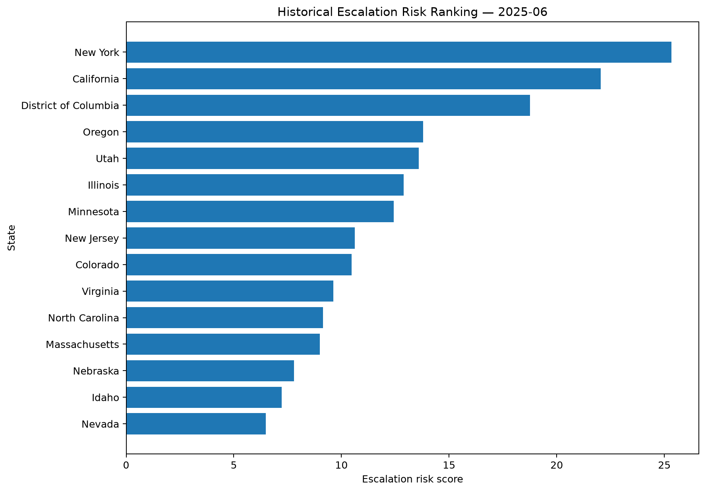
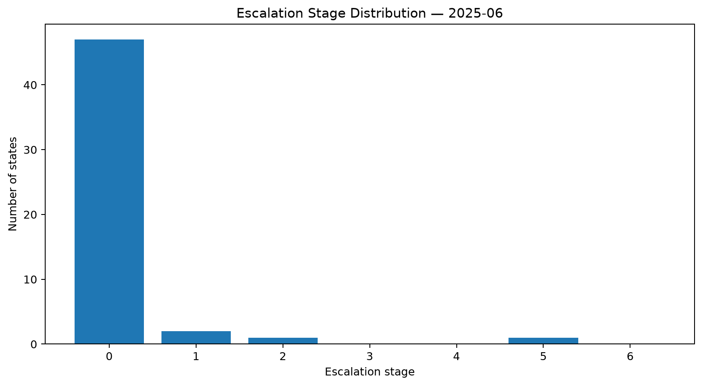
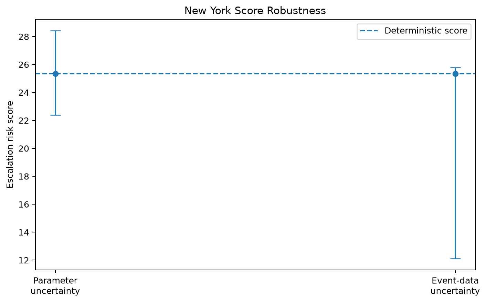
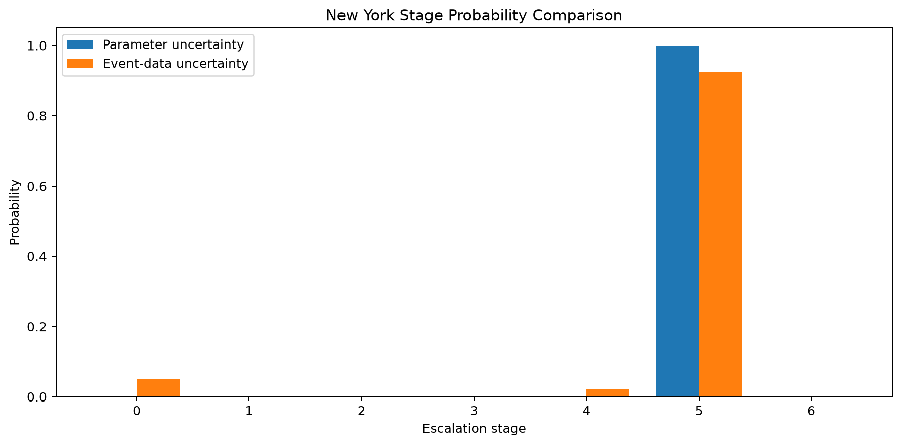
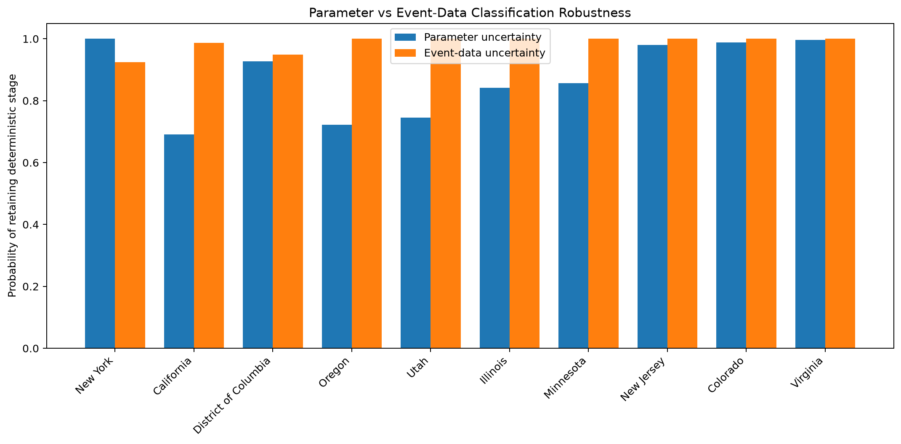
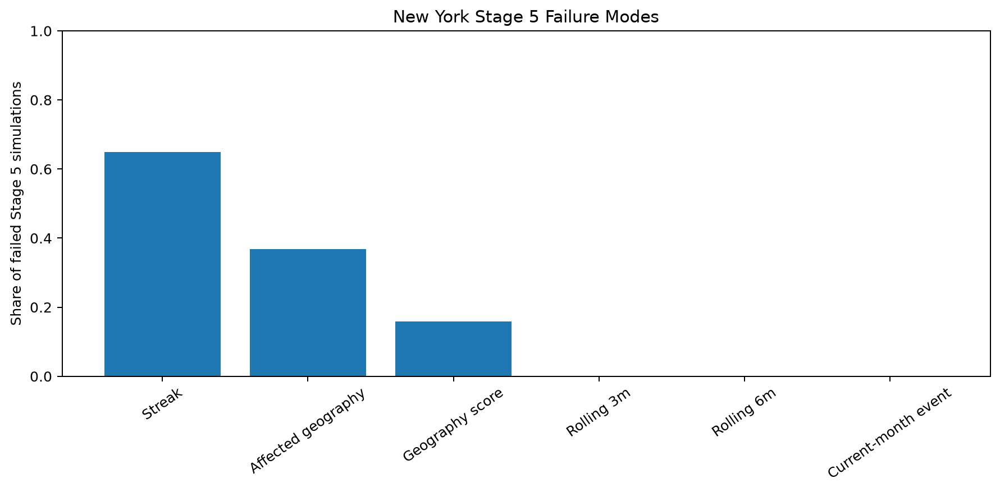

# U.S. Civil Conflict Escalation Risk Model

## Historical Analytical Report

**Latest complete historical month:** 2025-06

**Analytical status:** Historical calibration and robustness analysis. This is not a current U.S. civil-conflict assessment.

## Executive Summary

New York ranked first in the latest complete historical month, 2025-06, with a deterministic score of 25.34 and Stage 5: Multi-Geography Persistent Violence.

The result is robust to two distinct uncertainty classes:

- Parameter uncertainty: 100.0% probability of retaining the deterministic stage.
- Event-data uncertainty: 92.5% probability of retaining the deterministic stage.

New York's remaining uncertainty is primarily continuity-sensitive rather than volume-sensitive. Among failed Stage 5 simulations, 64.9% included a streak failure, while rolling 3-month and rolling 6-month volume gates failed in 0.0% and 0.0% of failures, respectively.

The event-pattern layer reports MODERATE continuity after actor-semantic normalization. No validated recurring specific actor structure was identified.

## Historical Ranking

| State | Risk Score | Stage | Stage Label |
| --- | --- | --- | --- |
| New York | 25.34 | 5 | Multi-Geography Persistent Violence |
| California | 22.05 | 1 | Elevated Composite Stress |
| District of Columbia | 18.75 | 1 | Elevated Composite Stress |
| Oregon | 13.80 | 0 | Baseline Political Competition |
| Utah | 13.59 | 0 | Baseline Political Competition |

> **Interpretation note:** Risk score measures composite intensity, while stage reflects whether specific observable escalation conditions are met. Higher score and higher stage are related but not interchangeable.

New York was the only state to meet Stage 5 conditions in the 2025-06 historical cross-section.

## Stage Distribution

## New York Robustness Profile

### Score robustness

- Deterministic score: 25.34
- Parameter uncertainty median: 25.34
- Parameter 90% interval: 22.38 to 28.42
- Event-data uncertainty median: 25.34
- Event-data 90% interval: 12.10 to 25.78

The event-data sensitivity interval is intentionally asymmetric because the simulation removes or reclassifies observed evidence; it does not invent new events.

### Stage robustness

- Parameter uncertainty Stage 5 probability: 100.0%
- Event-data uncertainty Stage 5 probability: 92.5%
- Event-data top-3 probability: 94.8%
- Event-data top-5 probability: 95.4%

## Parameter vs Event-Data Uncertainty

The robustness comparison distinguishes whether classification instability is driven primarily by calibration choices or by uncertainty in the event record.

For New York, the primary bottleneck is Event Data Uncertainty.

## Stage 5 Failure-Mode Decomposition

New York retained Stage 5 in 92.6% of failure-mode simulations.

Among failed simulations:

- Streak failure: 64.9%
- Affected-geography failure: 36.8%
- Geography-score failure: 15.9%
- Rolling 3-month volume failure: 0.0%
- Rolling 6-month volume failure: 0.0%
- Multi-gate failure: 15.9%

Failure-mode percentages overlap because a single failed simulation can fail more than one Stage 5 gate.

The most common exact failure pathway was **STREAK_FAILURE**, accounting for 48.9% of failed simulations.

## Pattern Continuity and Actor Semantics

New York's event-pattern continuity status is **MODERATE**.

- Specific actor signal: False
- State institution signal: False
- Dominant ACLED event type: Riots
- Dominant ACLED sub-event type: Mob violence
- Top recurring admin2 geography: Kings
- Excluded generic actor share: 92.3%

The actor-semantic audit removed broad labels such as generic civilians, protesters, rioters, and sole perpetrators from the primary specific-actor continuity signal. No recurring specific actor structure was validated.

## Data Freshness and Scope Limitation

The ACLED source is historical-only for the current project data.

- Latest observation in the current ACLED file: 2025-07-08
- Latest source month marked partial: True
- Latest complete report month: 2025-06

The report must not be presented as a current national assessment.

### Freshness register

| Source | Earliest Observation | Latest Observation | Assessed As Of | Age (Days) | Freshness Status | Latest Month Partial | Current Assessment Allowed |
| --- | --- | --- | --- | --- | --- | --- | --- |
| ACLED Event Dataset | 2025-01-01 | 2025-07-08 | 2026-07-08 | 365 | Historical Only | Yes | No |

## Methodological Interpretation

The historical New York result is:

- rank-robust;
- parameter-robust;
- highly but not perfectly event-data robust;
- volume-robust;
- persistence-sensitive;
- moderately sensitive to current-month geographic breadth;
- not supported by validated specific recurring actor continuity.

This combination is more informative than any single score or stage label.

## Research Boundary

This model is designed for aggregate historical research and early-warning methodology.

It does not identify private individuals, produce tactical target lists, forecast attacks, infer criminal intent, or provide coercive operational recommendations.
